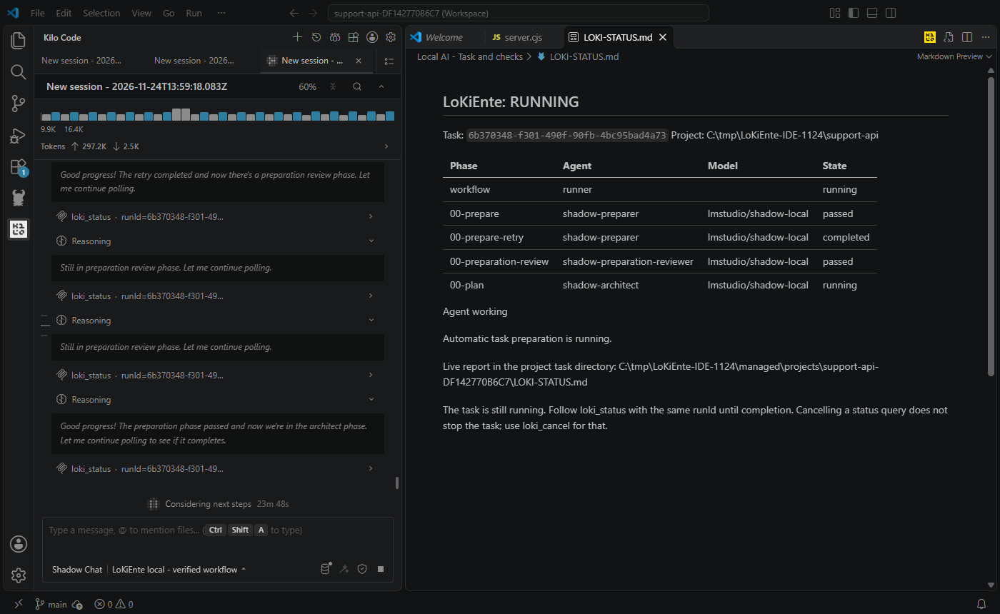

# LoKiEnte — local AI development with VS Code, Kilo and LM Studio

[Deutsch](README.de.md)

<p align="center">
  
</p>

LoKiEnte sets up a local AI development environment on Windows. You work in
**VS Code**, describe changes to **Kilo Code**, and run your models through
**LM Studio** on your own machine.

Its focus is **code changes you can inspect and verify**. Separate agent roles
prepare the task, plan, write tests, implement and review. Local test results and
review findings accompany the result; you inspect the diff and decide what to commit.

## What makes LoKiEnte useful

- **Local models, familiar tools.** Use your existing Git projects in VS Code
  with a managed local model provider and a separate LoKiEnte profile.
- **A reviewed development workflow.** Preparation, test authorship,
  implementation and independent reviews have distinct responsibilities.
- **Evidence for the actual code state.** Baseline tests, structured reports
  and final validation connect acceptance criteria to executed checks.
- **Models matched to the work.** Coding and review can use different models;
  the local router controls their use and checks available memory.
- **Projects that remain yours.** The desktop project picker supports Git
  discovery, cloning and repairing moved paths. Reprovisioning preserves custom
  project settings and backs up managed changes.

[Security](#security-and-control) · [Install](#quick-install-latest-release) ·
[Examples](#examples) · [Help](#diagnostics-and-troubleshooting) ·
[Detailed reference](docs/usage/README.md)

## Security and control

LoKiEnte combines several controls:

- **Local inference:** the managed configuration uses LM Studio through local
  loopback endpoints. API tokens are supplied through environment variables.
- **Tool permissions:** Kilo file and network permissions are checked with
  concrete permitted and denied operations. The [E.T. check](#et-security-check)
  reports tool enforcement separately from the model's response to instructions.
- **Controlled changes:** reviewed file boundaries, locked tests during
  implementation and project locks constrain the development workflow.
- **Checked dependencies:** provisioning resolves exact tool versions under the
  selected update policy, with a minimum release age of 48 hours. Installer
  checksums let you verify the downloaded file.
- **Visible results:** startup, connection and test failures reach the LoKiEnte
  Output channel and local reports. Missing or skipped evidence cannot become PASS.

**Normal execution uses your Windows account.** Kilo permissions and workflow
checks do not isolate every process from your files or network. Project test
commands need the same care as commands you run yourself. The optional offline
Hyper-V guest is a separate feature; ordinary installation and acceptance need
neither Hyper-V nor Docker. See [security, privacy and limits](SECURITY.md).

## Use LoKiEnte

Install the environment, run its acceptance check, then open a project through
the desktop shortcut. Start with the bundled example before using your own task.

### Requirements

- **Windows x64** on a PC, workstation or suitable VM. Linux and macOS are not
  supported by this installer.
- **Enough RAM, VRAM and disk space** for the selected models. Provisioning
  checks resources and offers suitable profiles. Automatic GPU checks target
  NVIDIA; other GPUs and CPU-only systems are not validated as equivalent setups.
- **Internet access for installation and downloads.** Models run locally;
  your project tools may still require network access.
- A regular Windows user account. **Windows PowerShell 5.1 can start the
  installer**, which provisions the required tools and PowerShell 7.4 or newer.
- For your own code tasks: a Git repository with at least one commit, installed
  project dependencies and executable tests. The bundled Welcome project lets
  you try the workflow before preparing your own project.

Program output and generated agent instructions use English. German companion
guides are available; third-party programs follow their own locale.

<a id="download-the-installer-and-run-it-from-its-folder"></a>
<a id="recommended-starting-point-dual-model-pool"></a>
<a id="dual-pool-with-an-additional-fast-model"></a>
<a id="dual-pool-with-fast-model-and-partial-gpu-offload"></a>
<a id="simpler-alternative-one-coding-model"></a>
<a id="optional-indexing-off-ondemand-or-automatic"></a>
<a id="powershell-recommended-with-checksum-verification"></a>
<a id="command-prompt-cmd-using-windows-curl"></a>
<a id="gnu-wget-if-installed-run-from-cmd"></a>

### Quick install: latest release

<p>
  <a href="https://github.com/mauricehuschke/LoKiEnte/releases/latest/download/Provision-LoKiEnte.ps1"></a>
  <a href="docs/usage/README.md#quick-install-latest-release"></a>
</p>

1. Download [Provision-LoKiEnte.ps1](https://github.com/mauricehuschke/LoKiEnte/releases/latest/download/Provision-LoKiEnte.ps1)
   and its [SHA-256 file](https://github.com/mauricehuschke/LoKiEnte/releases/latest/download/Provision-LoKiEnte.ps1.sha256)
   into a dedicated permanent folder, for example `D:\LoKiEnte`.
2. Open that folder in File Explorer, type `powershell` in the address bar and
   press Enter.
3. Verify the checksum and start provisioning:

```powershell
& {
    $ErrorActionPreference = 'Stop'
    $expected = ((Get-Content .\Provision-LoKiEnte.ps1.sha256 -Raw).Trim() -split '\s+')[0]
    $actual = (Get-FileHash .\Provision-LoKiEnte.ps1 -Algorithm SHA256).Hash
    if ($expected -notmatch '^[a-fA-F0-9]{64}$' -or $actual -ne $expected) { throw 'Installer checksum verification failed.' }
    powershell.exe -NoProfile -ExecutionPolicy Bypass -File .\Provision-LoKiEnte.ps1
}
```

The installer embeds the package; no repository clone or separate source ZIP is
needed. Without `-InstallRoot`, **the PS1's folder becomes the installation
directory**. For updates, select your exact existing directory. Base applications
and LM Studio model files retain their own locations.

Confirm the displayed directory with `y`, review the proposed models and finish
any requested LM Studio first-run setup. Dual mode is the default: a role-based
model pool used in controlled succession. Indexing defaults to Off. Additional
Fast models, partial GPU offload and Single mode are described in the
[installation variants](docs/usage/README.md#quick-install-latest-release).

The checksum verifies that the two downloads match; it is not a digital signature.
For a download pinned to one release and verified automatically, use the
[PowerShell download block](docs/usage/README.md#powershell-recommended-with-checksum-verification).

### Verify the installed toolchain

Provisioning asks **Run the real VS Code/Kilo/LM Studio acceptance? [Y/n]**.
Enter runs it. You can also select `-RunAcceptanceTest` or `-SkipAcceptanceTest`
explicitly; skipping leaves the environment unverified.

In the new VS Code window, review and grant Workspace Trust for the generated
test folder. If needed, choose **Manage Workspace Trust**. At the end, confirm
that the completed response is actually visible in Kilo. The check exercises the
installed extensions, CLI tools and real local model exchanges.

Read **Output → LoKiEnte** and `diagnostics/toolchain/latest.json`.
Only complete required evidence produces **PASS**; `FAIL`, `BLOCKED` and `SKIPPED`
need attention. [Test procedure and reports](docs/usage/README.md#verify-the-installed-toolchain)

### Everyday use

1. Open the **LoKiEnte desktop shortcut** and select a project. The dialog also
   offers **Browse folder**, **Find Git projects**, **Clone repository** and
   **Repair path** for moved projects. It does not leave a terminal window open.
2. Choose **`shadow-chat`** in Kilo and describe the change, its boundaries and
   expected behavior. Preparation derives suitable criteria and tests; unclear
   requirements or missing project dependencies produce a clarification request.
3. Follow the phase, role, assigned model and result in Kilo. Ask for details or
   cancellation when needed. Inspect the resulting diff and tests before committing.

Create a new project's scaffold and initial Git commit before requesting code
changes. LoKiEnte uses the selected checkout. [Complete user workflow](Quellpaket/WORKFLOW.md)

## Examples

<a id="add-head-to-an-existing-api"></a>

### First test task

**Bundled Welcome project:** provisioning registers a small example automatically.
Its [ready-to-use request](Quellpaket/welcome-example/README.md) is a starting point
for trying preparation, implementation and review.

**Extend an existing API:** the [Support API example](examples/support-board/README.md)
starts with a Node.js server whose `GET /api/summary` route rejects `HEAD`:

> Extend the server with HEAD /api/summary. Preserve GET and /health. Return the
> same status, Content-Type and byte Content-Length as GET, with an empty body.
> Add loopback HTTP integration tests and independent security and integration reviews.

[Starting application ZIP](examples/support-api-head-starter.zip) ·
[35-second walkthrough](assets/screenshots/developer-workflow.mp4) ·
[Detailed request, screenshots and results](docs/usage/README.md#first-test-task)

The eight-test reference uses the actual runner and HTTP tests with scripted
specialist replies. Separate [local model observations](examples/support-board/kilo-role-observations.json)
show mistakes exposed by those tests. These are distinct kinds of evidence.

### LoKiEnte in action



[Recorded model session and its observed outcome](https://lokiente.dev/#in-action) ·
[Local 9B validation record](Quellpaket/VALIDATION.md#local-9b-model-in-the-managed-kilo-ide)

<a id="optional-windows-security-profile"></a>

<a id="can-a-coding-assistant-fetch-a-file-during-a-local-task"></a>
<a id="what-the-example-run-showed"></a>

### E.T. security check

Choose **LoKiEnte duck → Run E.T. model rule test** and select your local model.
The editor report compares allowed file reads, protected files, network permissions
and model behavior. A model's refusal and a tool's enforced denial are evaluated
separately; an incomplete or inconclusive check stays unverified.

The published example passed 14 Kilo permission checks while the model failed
its instruction check. [Screenshots and evidence](docs/usage/README.md#et-security-check) ·
[Procedure and limits](SECURITY.md#local-et-model-test)

## How code verification works

Preparation and architecture establish the task and file boundaries. A test
author and independent test reviewer establish the checks before implementation.
The runner records the baseline, the implementer works with locked tests, and
code review plus separate validation assess the resulting source state.
Security and UI/API changes add their corresponding specialist reviews.

**`VERIFIED` refers to the tested source state.** Acceptance criteria must have
actual reported test evidence; exit code 0 alone is insufficient. Continue to
inspect the diff and behavior. [Workflow details](Quellpaket/WORKFLOW.md) ·
[HTTP verification record](examples/support-board/head-verification.json)

<a id="desktop-projects-and-provisioning-diagnostics"></a>
<a id="copilot-kilo-startup-and-settings-sync"></a>
<a id="if-local-indexing-fails-to-initialize"></a>
<a id="choose-how-development-tools-update"></a>

## Diagnostics and troubleshooting

| Where | What you find |
| --- | --- |
| **VS Code Output → LoKiEnte** | Managed startup, component messages and connection changes. |
| `provisioning-report.json` | Setup steps, environment, versions, command output, tests and partial failures. |
| `diagnostics/toolchain/latest.json` and `latest.junit.xml` | Latest live acceptance result; each run also has its own folder. |

Tokens are redacted, but reports may contain local paths and project information.
Inspect them before sharing. Dated historical logs are labelled as history;
current startup errors retain their severity. A reachable API alone is no
inference proof. [Detailed diagnostics](docs/usage/README.md#desktop-projects-and-provisioning-diagnostics)

### Frequently asked questions

- **Kilo is unavailable or a request hangs:** inspect LoKiEnte Output and the
  latest acceptance result; fully close managed windows after updating.
- **A project moved:** choose **Repair path** in the desktop project dialog.
- **Indexing is unavailable:** it starts Off; file search, subagents, reviews and
  tests remain available. [Indexing modes and setup](docs/usage/README.md#optional-indexing-off-ondemand-or-automatic)
- **A task needs input or lacks `VERIFIED`:** review the specific missing evidence
  or conflict. [Detailed FAQ](docs/usage/README.md#frequently-asked-questions)

## Update: replace the installer and provision again

Stop active tasks, close LoKiEnte VS Code windows, download and verify the current
installer, and run it with your **exact existing installation directory**:

```powershell
powershell.exe -NoProfile -ExecutionPolicy Bypass -File .\Provision-LoKiEnte.ps1 -InstallRoot 'D:\LoKi'
```

Enter keeps a matching existing model setup; `-ModelAction Configure` selects and
tests models again. Saved model choices and custom project settings are retained
unless explicitly changed. Choosing another `ModelMode` resets inherited model
options. No uninstall or `-UpdateManaged` switch is required.

`frozen`, `latest` and `lts` control eligible provisioning targets; the 48-hour
minimum age applies to each. Application updaters are separate. A new commit on
`main` is not itself a release download. [Full update procedure and policy](docs/usage/README.md#update-replace-the-installer-and-provision-again)

## All provisioning parameters and options

The [complete parameter reference](docs/usage/README.md#all-provisioning-parameters-and-options)
covers model modes, indexing, memory options, ports, project registration, update
policies and acceptance switches. It also retains alternate download commands,
extension-sync guidance and detailed recovery steps.

## More documentation

- [Installation, configuration and troubleshooting reference](docs/usage/README.md)
- [Complete user guide and workflows](Quellpaket/WORKFLOW.md)
- [Security, privacy and optional isolation](SECURITY.md)
- [Validation evidence and limits](Quellpaket/VALIDATION.md)
- [Customize or contribute to LoKiEnte](docs/development/README.md)
- [Report a bug or suggest an improvement](https://github.com/mauricehuschke/LoKiEnte/issues)

## License

[Apache License 2.0 with Commons Clause 1.0](LICENSE.txt) permits cloning,
forking, modification, free redistribution and commercial internal use under
its terms. The Commons Clause restricts selling products or services whose
value derives entirely or substantially from LoKiEnte's functionality; this
can also cover hosting and consulting/support. The two texts apply together.

**Projects and work products developed with LoKiEnte may be used commercially
and sold.** Using LoKiEnte does not put those independent results under its
license. LoKiEnte code actually incorporated into a product retains its license
conditions; third-party materials retain their respective licenses.

This combined license is **source available, not OSI open source**. Read the
[full terms](LICENSE.txt) or the [German explanatory notes](LICENSE.de.txt).
